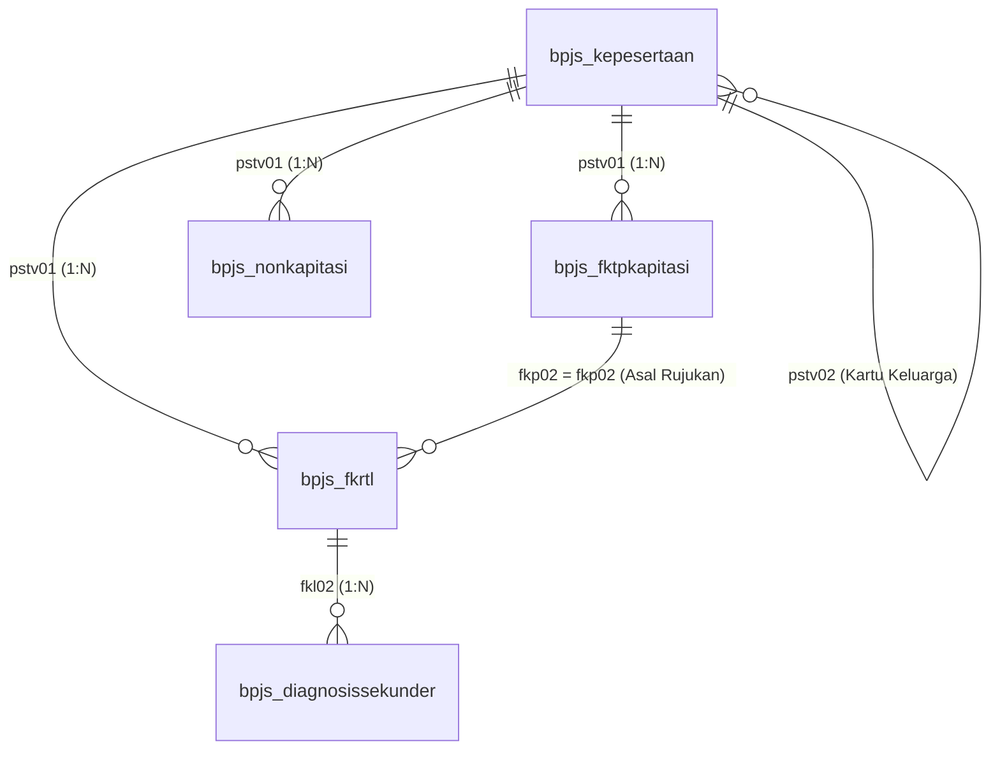

# AI Agent Knowledge Base: Data Sampel BPJS Kesehatan (2015–2024)

Dokumen ini adalah **panduan pengetahuan teknis (system knowledge base)** untuk AI Agents (LLM, Text-to-SQL, atau AI Assistant) dalam memahami skema, perilaku database (*database behaviour*), aturan bisnis (*business rules*), serta kapabilitas menjawab pertanyaan dari **Data Sampel BPJS Kesehatan (Edisi 2025)**.

---

## 1. System Prompt & Instruksi Konteks untuk AI Agent

Saat bertindak sebagai asisten data BPJS Kesehatan, AI Agent **WAJIB** mematuhi prinsip operasional berikut:
1. **Case-Insensitive Database Mapping**: Berkas mentah Stata (`.dta`) menggunakan huruf kapital (`PSTV01`, `FKP02`, dsb.), namun saat diimpor ke PostgreSQL (via `import_bpjs_to_postgres.py`), seluruh nama tabel dan kolom dinormalisasi menjadi **lowercase** (`pstv01`, `fkp02`, `fkl02`).
2. **Aturan Pembobotan Nasional (`pstv15`)**: Data ini adalah data sampel representatif berbobot (*sampling weight*).
   * **Menghitung Frekuensi/Kasus Populasi**: Gunakan `SUM(pstv15)`, **BUKAN** `COUNT(*)`.
   * **Menghitung Total Biaya Populasi**: Gunakan `SUM(biaya * pstv15)`.
   * **Menghitung Rata-rata Biaya**: Gunakan `SUM(biaya * pstv15) / SUM(pstv15)`.
3. **Pembedaan Biaya Tagih vs Biaya Riil**:
   * `fkl47` = Biaya yang ditagihkan oleh faskes/RS (*provider billing*).
   * `fkl48` = **Biaya Verifikasi Klaim Riil** yang disetujui dan dibayarkan oleh BPJS Kesehatan (gunakan kolom ini untuk analisis pembiayaan BPJS).
4. **Pencegahan Duplikasi Kunjungan (Row Explosion)**:
   * Tabel `bpjs_diagnosissekunder` berelasi `1 : N` dengan `bpjs_fkrtl`. **JANGAN** lakukan `LEFT JOIN` ke diagnosis sekunder saat menjumlahkan biaya klaim atau menghitung total kunjungan tanpa melakukan deduplikasi/agregasi terlebih dahulu.

---

## 2. Perilaku Database (Database Behaviour & Schemas)

### A. Diagram Relasi Entitas & Alur Join Kunci



### B. Perilaku Spesifik Tiap Tabel

#### 1. `bpjs_kepesertaan` (Dimensi Profil Peserta)
* **Primary Key Konseptual**: `pstv01` (ID Peserta).
* **Household Grouping**: `pstv02` (Nomor Kartu Keluarga). Semua anggota keluarga dalam 1 KK memiliki `pstv02` yang sama.
* **Perilaku Kolom**:
  * `pstv03` (Tanggal Lahir): Digunakan untuk menghitung umur presisi saat tanggal kunjungan: `EXTRACT(YEAR FROM AGE(kunjungan.tgl, p.pstv03))`.
  * `pstv07` (Kelas Rawat): Kelas hak peserta (1, 2, atau 3). Nilai `9` = Missing.
  * `pstv08` (Segmentasi Sosio-Ekonomi): `2`=PBI APBN dan `3`=PBI APBD (masyarakat miskin penerima subsidi), `4`=PBPU (peserta mandiri), `5`=PPU (pekerja formal/swasta/PNS).
  * `pstv09_new` & `pstv10`: Kode Provinsi (38 provinsi baru) dan Kode Kabupaten/Kota domisili tempat tinggal peserta.
  * `pstv11` & `pstv12`: Kepemilikan dan tipe faskes primer tempat peserta terdaftar (`1`=Puskesmas, `2`=Klinik Pratama, `3`=Dokter Umum).
  * `pstv17` (Status Kepesertaan): `1`=Aktif, `2`=Meninggal, `3`=PHK, dst.
  * `pstv18` (Tahun Meninggal): Format teks tahun (misal: `'2023'`), bernilai `NULL` jika masih hidup.

#### 2. `bpjs_fktpkapitasi` (Fasilitas Kesehatan Tingkat Pertama)
* **Primary Key**: `fkp02` (ID Kunjungan FKTP).
* **Foreign Key**: `pstv01` $\to$ `bpjs_kepesertaan.pstv01`.
* **Perilaku Kolom**:
  * `fkp22` (Kunjungan Sakit vs Sehat): `1`=Kunjungan Sakit (kuratif), `2`=Kunjungan Sehat (promotif/preventif/skrining/imunisasi).
  * `fkp13` (Status Pulang): `1`=Berobat Jalan, `2`=Rujuk Lanjut (ke RS), `3`=Sembuh, `7`=Meninggal.
  * `fkp14a` (Diagnosis ICD-10 3-Digit): Kode diagnosis utama di FKTP (misal: `I10` untuk Hipertensi, `E11` untuk DM Tipe 2).
  * **Perilaku Rujukan**:
    * Jika `fkp13 = 2` (Rujuk Lanjut), kolom tujuan rujukan (`fkp16_new`, `fkp17`, `fkp19`, `fkp21`) akan terisi kode RS dan poli tujuan rujukan.
    * Jika `fkp13 != 2` (tidak dirujuk), kolom rujukan biasanya bernilai `98` (Tidak Dirujuk) atau `NULL`.

#### 3. `bpjs_fkrtl` (Fasilitas Kesehatan Rujukan Tingkat Lanjut / RS)
* **Primary Key**: `fkl02` (ID Kunjungan FKRTL).
* **Foreign Key**: `pstv01` $\to$ `bpjs_kepesertaan.pstv01`.
* **Rujukan Join Key**: `fkp02` (Nomor Asal Rujukan).
  * **PERINGATAN**: Tidak semua kunjungan RS berasal dari rujukan FKTP! Kunjungan langsung ke IGD/Emergency atau rujukan antar-RS akan memiliki `fkp02` bernilai `NULL` atau string non-FKTP. Selalu gunakan `LEFT JOIN` jika menghubungkan FKTP ke FKRTL.
* **Perilaku Kolom**:
  * `fkl10` (Tingkat Layanan): `1`=RJTL (Rawat Jalan Tingkat Lanjut), `2`=RITL (Rawat Inap Tingkat Lanjut).
  * `fkl03` & `fkl04` (Tanggal Masuk & Pulang): *Length of Stay* (LOS) dihitung dengan `(fkl04 - fkl03)`. Pada rawat jalan (RJTL), `fkl03 = fkl04` (LOS = 0).
  * `fkl09` (Kelas Rumah Sakit): `1`=Kelas A, `2`=Kelas B, `3`=Kelas C, `4`=Kelas D.
  * `fkl14` (Status Keluar RS): `1`=Atas Persetujuan Dokter (Sembuh/Membaik), `2`=Rujuk RS Lain, `3`=Pulang Paksa, `4`=Meninggal.
  * `fkl17a` & `fkl18a`: Kode ICD-10 3 digit dan nama diagnosis primer definitif setelah perawatan.
  * `fkl19` & `fkl19a`: Kode INACBGs (contoh: `Q-5-44-0`) dan deskripsinya.
  * `fkl23` (Tingkat Keparahan / Severity): `1`=Rawat Jalan, `2`=Rawat Inap Ringan (I), `3`=Rawat Inap Sedang (II), `4`=Rawat Inap Berat (III).
  * `fkl48` (Biaya Verifikasi): Nominal riil klaim yang dibayar BPJS.

#### 4. `bpjs_nonkapitasi` (Klaim Khusus FKTP di Luar Paket Kapitasi)
* **Primary Key**: `pnk02` (ID Kunjungan Non-Kapitasi).
* **Foreign Key**: `pstv01` $\to$ `bpjs_kepesertaan.pstv01`.
* **Perilaku Data**: Menyimpan klaim persalinan/kebidanan, ambulans, dan skrining lab Gula Darah Puasa (GDP) pada kolom `pnk19` dan `pnk20`. Biaya riil dibayar ada pada kolom `pnk18`.

#### 5. `bpjs_diagnosissekunder` (Komorbiditas / Multi-Diagnosis)
* **Foreign Key**: `fkl02` $\to$ `bpjs_fkrtl.fkl02`.
* **Kardinalitas**: `N : 1` ke `bpjs_fkrtl`.
* **Kolom**: `fkl24a` (Kode ICD-10 3 digit), `fkl24b` (Deskripsi diagnosis sekunder).

---

## 3. Kamus Nilai & Lookup Codes (Untuk Filter AI)

AI Agent dapat langsung menggunakan nilai-nilai kategorikal berikut dalam klausa `WHERE`:

| Variabel | Deskripsi | Nilai Kunci & Arti |
| :--- | :--- | :--- |
| `pstv04` | Hubungan Keluarga | `1`=Peserta/Kepala, `2`=Suami, `3`=Istri, `4`=Anak, `5`=Tambahan |
| `pstv05` | Jenis Kelamin | `1`=Laki-Laki, `2`=Perempuan |
| `pstv06` | Status Pernikahan | `1`=Belum Kawin, `2`=Kawin, `3`=Cerai, `9`=Tidak Terdefinisi |
| `pstv07` | Hak Kelas Rawat | `1`=Kelas I, `2`=Kelas II, `3`=Kelas III, `9`=Missing |
| `pstv08` | Segmen Peserta | `1`=Bukan Pekerja, `2`=PBI APBN, `3`=PBI APBD, `4`=PBPU (Mandiri), `5`=PPU (Pekerja) |
| `pstv17` | Status Keaktifan | `1`=Aktif, `2`=Meninggal, `3`=PHK, `4`=Keluar Sendiri, `5`=Habis PKS |
| `fkp10` / `fkl10` | Tingkat Layanan | `1`=Rawat Jalan, `2`=Rawat Inap, `3`=Promotif |
| `fkp13` | Status Pulang FKTP | `1`=Berobat Jalan, `2`=Rujuk Lanjut (ke RS), `3`=Sembuh, `7`=Meninggal |
| `fkp22` | Jenis Kunjungan FKTP | `1`=Kunjungan Sakit (Kuratif), `2`=Kunjungan Sehat (Preventif/Promotif) |
| `fkl07` | Kepemilikan RS | `1`=Pemerintah Pusat/Vertikal, `2`=Pemprov, `3`=Pemkab, `9`=Swasta |
| `fkl09` | Kelas/Tipe RS | `1`=Kelas A, `2`=Kelas B, `3`=Kelas C, `4`=Kelas D |
| `fkl14` | Status Pulang RS | `1`=Persetujuan Dokter, `2`=Rujuk RS Lain, `3`=Pulang Paksa, `4`=Meninggal |
| `fkl23` | Severity Level | `1`=Rawat Jalan, `2`=Ringan (I), `3`=Sedang (II), `4`=Berat (III) |
| `pstv21` | Status Vaksin (COVID) | `1`=Sudah Vaksin, `2`=Belum Vaksin |
| `pstv22` | Status Komorbid (COVID)| `1`=Ada Komorbid, `2`=Tidak Ada Komorbid |

---

## 4. Intent & Pertanyaan yang Bisa Dijawab (Solusi Query AI)

Gunakan pemetaan intent berikut untuk mengidentifikasi tabel dan logika query yang tepat:

### A. Kategori Pertanyaan: Profil & Perilaku User (User-Centric)

#### 1. "Berapa banyak peserta yang datang untuk kunjungan sehat vs kunjungan sakit berdasarkan kelompok umur/segmen?"
* **Logika**: Join `bpjs_kepesertaan` dengan `bpjs_fktpkapitasi`.
* **Kolom**: `pstv08`, `fkp22` (`1`=Sakit, `2`=Sehat), hitung usia dari `pstv03` dan `fkp03`.
* **Pola Query**:
  ```sql
  SELECT 
      p.pstv08 AS kode_segmen,
      CASE 
          WHEN EXTRACT(YEAR FROM AGE(k.fkp03, p.pstv03)) < 18 THEN '<18'
          WHEN EXTRACT(YEAR FROM AGE(k.fkp03, p.pstv03)) BETWEEN 18 AND 59 THEN '18-59'
          ELSE '60+'
      END AS kelompok_usia,
      SUM(CASE WHEN k.fkp22 = 1 THEN k.pstv15 ELSE 0 END) AS kasus_sakit_populasi,
      SUM(CASE WHEN k.fkp22 = 2 THEN k.pstv15 ELSE 0 END) AS kasus_sehat_populasi
  FROM bpjs_kepesertaan p
  JOIN bpjs_fktpkapitasi k ON p.pstv01 = k.pstv01
  GROUP BY 1, 2;
  ```

#### 2. "Apakah ada peserta yang berobat di luar kabupaten/kota tempat tinggalnya (Medical Travel)?"
* **Logika**: Bandingkan domisili peserta (`p.pstv10`) dengan kabupaten/kota faskes yang dikunjungi (`k.fkp06` atau `r.fkl06`).
* **Pola Query**:
  ```sql
  SELECT 
      p.pstv10 AS kab_domisili_peserta,
      r.fkl06 AS kab_lokasi_rs,
      COUNT(*) AS frekuensi_sampel,
      SUM(r.pstv15) AS estimasi_kunjungan_populasi
  FROM bpjs_fkrtl r
  JOIN bpjs_kepesertaan p ON r.pstv01 = p.pstv01
  WHERE p.pstv10 <> r.fkl06
  GROUP BY 1, 2
  ORDER BY estimasi_kunjungan_populasi DESC;
  ```

#### 3. "Bagaimana pola kepatuhan kontrol bulanan pasien kronis (misal Diabetes / Hipertensi)?"
* **Logika**: Gunakan window function `LAG(fkp03)` partition by `pstv01` untuk menghitung jeda hari antar kunjungan berturut-turut pada peserta dengan diagnosis `E11` atau `I10`.

---

### B. Kategori Pertanyaan: Operasional Sistem Rujukan Berjenjang

#### 1. "Berapa rasio rujukan dari FKTP ke RS, dan diagnosa apa yang paling sering dirujuk?"
* **Logika**: Filter `bpjs_fktpkapitasi` dengan `fkp13 = 2` (Rujuk Lanjut).
* **Pola Query**:
  ```sql
  SELECT 
      k.fkp14a AS kode_icd10,
      MAX(k.fkp15a) AS nama_diagnosis,
      COUNT(*) AS total_sampel_rujukan,
      ROUND(SUM(k.pstv15)::numeric, 0) AS total_rujukan_nasional
  FROM bpjs_fktpkapitasi k
  WHERE k.fkp13 = 2
  GROUP BY k.fkp14a
  ORDER BY total_rujukan_nasional DESC
  LIMIT 10;
  ```

#### 2. "Apakah ada kebocoran rujukan vertikal (langsung ke RS Tipe A/B tanpa melewati Tipe C/D)?"
* **Logika**: Filter kunjungan rujukan FKTP (`fkp19 = 1`) yang langsung diarahkan ke tipe RS kelas A (`fkp20 = 1`) atau B (`fkp20 = 2`).

---

### C. Kategori Pertanyaan: Ekonomi Kesehatan & Beban Biaya Klaim

#### 1. "Berapa total klaim riil yang dibayarkan BPJS untuk 10 diagnosis rawat inap tertinggi?"
* **Logika**: Filter `fkl10 = 2` (Rawat Inap), kalikan `fkl48` dengan `fkl15` (bobot sampling).
* **Pola Query**:
  ```sql
  SELECT 
      r.fkl17a AS kode_icd10,
      MAX(r.fkl18a) AS diagnosis_primer,
      ROUND(SUM(r.pstv15)::numeric, 0) AS kasus_nasional,
      ROUND(SUM(r.fkl48 * r.pstv15)::numeric, 2) AS total_biaya_klaim_bpjs_rp,
      ROUND((SUM(r.fkl48 * r.pstv15) / SUM(r.pstv15))::numeric, 2) AS rata_rata_biaya_klaim_rp
  FROM bpjs_fkrtl r
  WHERE r.fkl10 = 2
  GROUP BY r.fkl17a
  ORDER BY total_biaya_klaim_bpjs_rp DESC
  LIMIT 10;
  ```

#### 2. "Berapa selisih antara tagihan yang diajukan RS vs yang disetujui BPJS (Dispute/Koreksi Klaim)?"
* **Logika**: Bandingkan `SUM(fkl47)` (Tagih RS) dengan `SUM(fkl48)` (Verifikasi BPJS) per tipe kepemilikan RS (`fkl07`).

---

### D. Kategori Pertanyaan: Kualitas Klinis & Keselamatan Pasien

#### 1. "Berapa angka readmisi rawat inap dalam 30 hari untuk penyakit yang sama?"
* **Logika**: Window function `LAG(fkl04)` over `pstv01` pada rawat inap (`fkl10 = 2`) dengan syarat `fkl03 - LAG(fkl04) BETWEEN 1 AND 30`.

#### 2. "Berapa angka kematian di rumah sakit (*In-Hospital Mortality Rate*) berdasarkan tingkat keparahan (Severity Level)?"
* **Logika**:
  ```sql
  SELECT 
      r.fkl23 AS severity_level,
      COUNT(*) AS total_pasien_rawat_inap,
      COUNT(*) FILTER (WHERE r.fkl14 = 4) AS jumlah_pasien_meninggal,
      ROUND(COUNT(*) FILTER (WHERE r.fkl14 = 4)::numeric / COUNT(*) * 100, 2) AS mortalitas_persen
  FROM bpjs_fkrtl r
  WHERE r.fkl10 = 2
  GROUP BY r.fkl23
  ORDER BY r.fkl23;
  ```

---

### E. Kategori Pertanyaan: Subset Kontekstual Khusus

1. **Kesehatan Ibu dan Anak (KIA)**:
   * **Pertanyaan**: "Apakah bayi yang dirawat intensif (perinatologi/NICU) berhubungan dengan komplikasi kehamilan ibu?"
   * **Join Key**: Hubungkan tabel `kia_anak` dengan `kia_ibu` menggunakan `anak.pstv01_a = ibu.pstv01`.
2. **COVID-19 & Vaksinasi**:
   * **Pertanyaan**: "Apakah status sudah vaksin (`pstv21 = 1`) berhubungan dengan tingkat keparahan rawat inap (`fkl23`) yang lebih rendah?"
   * **Logika**: Bandingkan distribusi `fkl23` pada grup `pstv21 = 1` vs `pstv21 = 2`.

---

## 5. Pertanyaan yang TIDAK BISA Dijawab (Batasan Keras / Limitations)

Jika user mengajukan pertanyaan-pertanyaan di bawah ini, AI Agent **WAJIB MENOLAK** secara sopan dan menjelaskan bahwa variabel tersebut tidak tersedia di data administratif BPJS:

| Pertanyaan Pengguna | Status di Data | Penjelasan & Alternatif yang Dapat Diberikan |
| :--- | :--- | :--- |
| *"Siapa nama pasien / siapa yang beralamat di Jl. X?"* | **TIDAK BISA** | Data tidak memuat PII (Nama, NIK, alamat jalan). Alternatif: Analisis agregat level Kabupaten/Kota (`pstv10`). |
| *"Berapa gaji riil / pendapatan bulanan peserta?"* | **TIDAK BISA** | Tidak ada nominal rupiah gaji. Alternatif: Dekati dengan Segmen Peserta (`pstv08`: PBI/Miskin vs PBPU/Mandiri vs PPU/Pekerja) dan Hak Kelas Rawat (`pstv07`). |
| *"Apakah pasien merokok atau berapa tensi/tekanan darahnya?"* | **TIDAK BISA** | Tidak ada data gaya hidup harian atau catatan tensi rutin faskes primer, kecuali jika dokter membuat diagnosis klinis formal di ICD-10 (misal `I10` Hipertensi atau `Z72.0` Penggunaan Tembakau). |
| *"Bagaimana rating / kepuasan pasien terhadap pelayanan dokter?"* | **TIDAK BISA** | Tidak ada survei kepuasan pelanggan / NPS di data klaim. Alternatif: Ukur secara tidak langsung dari lama hari rawat (LOS) atau kasus pulang paksa (`fkl14 = 3`). |
| *"Bagaimana tren kunjungan rawat inap pasien reguler dari tahun 2015 sampai 2024?"* | **TIDAK BISA** | Tabel transaksi kunjungan reguler (`FKTP` & `FKRTL`) pada edisi 2025 hanya mencakup transaksi tahun **2024**. Transaksi longitudinal penuh 2015–2024 hanya ada pada subset kontekstual COVID-19. |

---

## 6. Ringkasan Template Query AI Agent (Golden Template)

Saat AI Agent diminta membuat query komprehensif, gunakan template acuan berikut:

```sql
-- Template Standar AI: Agregasi Terbobot Nasional
SELECT 
    f.fkl17a AS icd10_kode,
    MAX(f.fkl18a) AS icd10_nama,
    p.pstv08 AS kode_segmen,
    -- 1. Sampel Baris
    COUNT(DISTINCT f.fkl02) AS n_sample_kunjungan,
    -- 2. Estimasi Nasional Terbobot
    ROUND(SUM(f.pstv15)::numeric, 0) AS estimasi_kunjungan_nasional,
    -- 3. Finansial Terbobot
    ROUND(SUM(f.fkl48 * f.pstv15)::numeric, 2) AS total_biaya_bpjs_nasional_rp,
    -- 4. Rata-rata Biaya Per Pasien
    ROUND((SUM(f.fkl48 * f.pstv15) / SUM(f.pstv15))::numeric, 2) AS avg_biaya_per_kasus_rp
FROM bpjs_fkrtl f
INNER JOIN bpjs_kepesertaan p ON f.pstv01 = p.pstv01
WHERE f.fkl10 = 2 -- Rawat Inap
  AND f.fkl03 >= '2024-01-01' AND f.fkl03 <= '2024-12-31'
GROUP BY f.fkl17a, p.pstv08
ORDER BY total_biaya_bpjs_nasional_rp DESC;
```